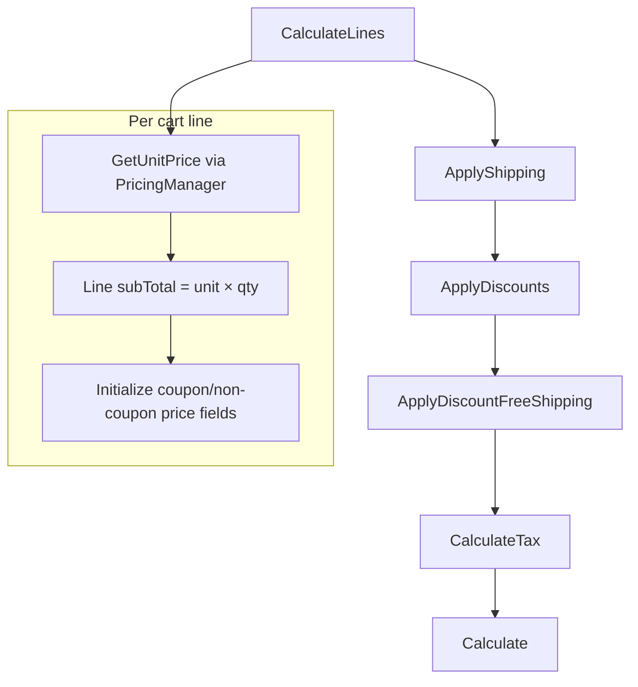
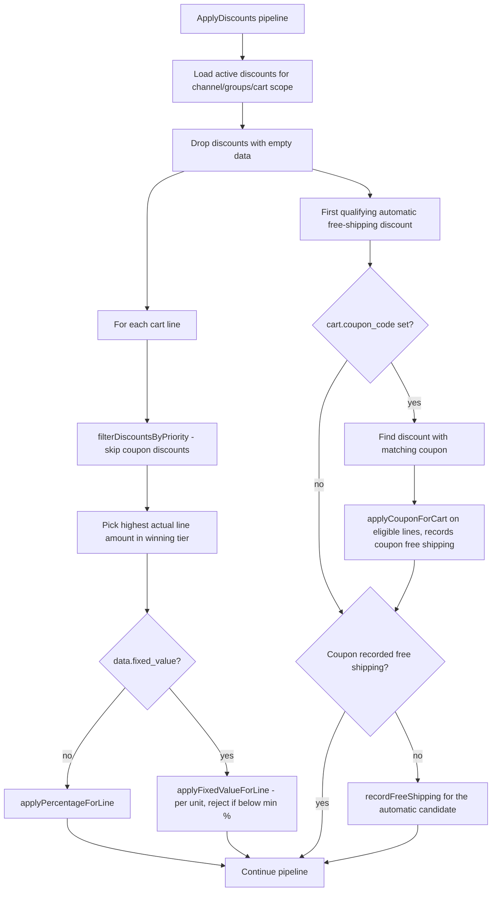

# Pricing and Discounts — Software Design Document (Engine)

Last verified: 2026-07-31 against `lunarphp/lunar-minic` at repository HEAD.

## Purpose and scope

This document explains how **unit prices are resolved** and how **discounts are evaluated and applied** in this repository, including fork-specific coupon vs non-coupon totals.

**In scope:** `Price` records, `PricingManager`, cart calculation pipelines, `DiscountManager`, `AdvancedAmountOff`, tax interaction, catalog display helpers, and integration touchpoints (shipping tiers, order snapshots).

**Documented elsewhere (not repeated here):**

- Full cart/checkout flow — [checkout.md](./checkout.md)
- Order placement and post-create lifecycle — [order_processing.md](./order_processing.md)
- File-level navigation — [CODE_MAP.md](../system/CODE_MAP.md) § Pricing & tax, Discounts
- Storefront checkout wiring — sibling `minic/lunar-frontend` (referenced only where it extends engine behavior; not shipped from this repo)

---

## Pricing architecture

### Price model

Purchasable items (typically `ProductVariant`) own morph `Price` rows with:

| Dimension | Behavior |
| --- | --- |
| **Currency** | One price set per `currency_id`; missing currency prices throw `MissingCurrencyPriceException` |
| **Customer group** | Optional `customer_group_id`; `null` means available to all groups |
| **Quantity** | `min_quantity` (default tier at `1`); higher `min_quantity` values act as **quantity breaks** when cart line qty qualifies |
| **Compare price** | Optional list/strike price (display; not used in cart pipeline logic reviewed) |
| **`max_quantity`** | Fork column on `prices` (nullable); used outside cart pricing (e.g. table-rate tier logic per PROJECT_SPECIFICATION) |

There is **no per-channel price row** in core. **Channels** constrain product/discount *eligibility* (`HasChannels`), not which `Price` row is selected.

### Price resolution (`PricingManager`)

Entry point: `Pricing` facade → `PricingManager::for($purchasable)->get()`.

Resolution inputs (fluent setters): purchasable, currency, quantity, customer groups, optional authenticated user.

**Customer group selection order:**

1. Explicit `customerGroups()` on the manager, else default customer group
2. If a Lunar user is set and has customers, **replace** with that user’s customers’ groups

**Matching algorithm** (same currency, filtered by customer groups, sorted by ascending `price`):

1. Base: `min_quantity = 1` and no customer group
2. Override with cheapest **customer-group** price at `min_quantity = 1` if any
3. Override with cheapest **quantity break** where `min_quantity > 1` and `qty >= min_quantity`

Returns a `PricingResponse` DTO: `matched`, `base`, `priceBreaks`, `customerGroupPrices`.

Optional **`lunar.pricing.pipelines`** can transform the manager before the response is returned (empty by default).

### Tax interaction (pricing)

Controlled by `lunar.pricing.stored_inclusive_of_tax` (`LUNAR_STORE_INCLUSIVE_OF_TAX`):

| Mode | Stored prices | Display / cart line unit |
| --- | --- | --- |
| Exclusive (default) | Ex tax | `GetUnitPrice` sets `unitPrice` (ex) and `unitPriceInclTax` via purchasable tax rate |
| Inclusive | Inc tax | Tax helpers short-circuit; line totals treat stored values as tax-inclusive where `prices_inc_tax()` applies |

Tax **amounts** on carts are computed later in `CalculateTax` via `TaxManager` / `Taxes` facade (addresses, purchasable tax class, discounted subtotals).

### Catalog display pricing

`HasDiscount` on purchasables exposes `getOriginalPrices()`, `getDiscountedPrices()`, `getDiscountAmounts()`, and inc-tax variants of each for **storefront/catalog display**, using the same `DiscountManager::getDiscountForPurchasable()` priority rules and `AdvancedAmountOff::calculateDiscountedPrice()` for preview amounts. This path is separate from cart recalculation but shares discount selection logic.

`getDiscountLabels()` builds the badge text. A percentage discount is labelled `"10%"`. A fixed-value discount is labelled from the **computed inc-tax saving** (`getDiscountAmountsIncTax()`), *not* from the raw `data.fixed_values` entry, because that raw value follows the storage basis (`lunar.pricing.stored_inclusive_of_tax`) while storefronts display inc-tax prices — a £100 off a net-stored price is a £121 saving to the shopper at 21% tax. Deriving the label from the computed amount also means no label is emitted when the discount was not actually granted (e.g. rejected by `fixed_value_minimum_remaining_percentage`). Labels use `Price::formattedWithoutZeroDecimals()`, which omits the decimals when they are exactly zero (`-£121`, but `-£121.50` kept); the global `DefaultPriceFormatter` output is unchanged.

---

## Discount architecture

### Discount model

`Discount` records represent promotions. Notable attributes:

| Area | Behavior |
| --- | --- |
| **Type** | PHP class name (active: `AdvancedAmountOff`) |
| **`data` JSON** | Reward config: `percentage`, optional `fixed_value` / `fixed_values`, `min_prices` per currency, optional `free_shipping` (Advanced amount off only, see "Free shipping" below) |
| **Coupon** | Optional code (`CouponString` cast, uppercased) |
| **Schedule** | `starts_at` / `ends_at`; `scopeActive()` |
| **Usage** | `uses`, `max_uses`, `max_uses_per_user` (+ user pivot) |
| **Priority** | SQL `orderBy priority desc` when loading candidates |
| **Limitations** | `discountables` (product/variant), `collections`, `brands` with pivot `type` (`condition`, `limitation`, `exclusion`) |
| **Audience** | `HasChannels`, `HasCustomerGroups`, optional `customers` relation |
| **Status attribute** | Computed: `active`, `pending`, `expired`, `scheduled` |

### Enabled discount types (fork)

`DiscountManager` registers **`AdvancedAmountOff`** and **`BuyXGetY`**. `AmountOff` remains disabled. BXGY uses cart-level `BuyXGetY::apply()` (including optional `automatically_add_rewards` and parent-line `selected_gift_rewards` meta for multi-gift PDP picks).

**Dual-use rewards:** the same catalog product/variant may be sold at full price and also granted as a free BXGY gift. With `automatically_add_rewards`, free units are always a **separate** cart line tagged `meta.added_by_discount` — they never merge into or discount a shopper-paid line for the same purchasable. Condition `min_qty` ignores gift lines. Catalog price may stay normal; freeness comes from the gift-line discount, not a dedicated zero-price SKU. `gift_only` remains an optional storefront ATC block for rewards that must never be sold standalone.

`CouponValidator` still queries all three class names for coupon existence checks.

### Discount manager

Entry point: `Discounts` facade → **scoped** `DiscountManager` (`LunarServiceProvider` binds `DiscountManagerInterface` scoped, not singleton). The manager caches the loaded discount collection for the remainder of that request until `resetDiscounts()` clears it. The production storefront (`lunar-frontend`) calls `resetDiscounts()` when applying or removing coupons.

Responsibilities:

- Scope discounts by channel, customer group, cart contents (products, variants, collections)
- Pick **one automatic discount per cart line** via priority rules
- Apply **one coupon discount** when `cart.coupon_code` matches
- Track `discountBreakdown` and applied discount types on the cart during calculation

Configurable: `lunar.discounts.coupon_validator` (default `CouponValidator`). The storefront package may add validation rules (e.g. `CouponIsCorrect`, `MaxUsesPerUser` in `lunar-frontend`) before `cart.coupon_code` is set; core `CouponValidator` still governs `Discounts::validateCoupon()`.

Also configurable: `lunar.discounts.fixed_value_minimum_remaining_percentage` (default `10`) — the minimum percentage of a cart line's subtotal that must remain after a **coupon-less** fixed-value discount is deducted; if it would leave less (or exceed the subtotal entirely), the discount is not applied at all — never partially applied/capped (see "Automatic line reward" below).

### Conditions and rewards (`AdvancedAmountOff` + `AbstractDiscountType`)

**Conditions** (`checkDiscountConditions`):

| Rule | Effect |
| --- | --- |
| Customer allow-list | If discount has `customers`, cart must have matching `customer_id` |
| Coupon match | If discount has a coupon, cart `coupon_code` must match (case-insensitive) |
| Min spend | `min_prices[currency]` compared to sum of **eligible lines’** `subTotal` |
| Max uses | Global `uses < max_uses` when `max_uses` set |
| Max uses per user | Requires cart user; compares pivot use count |

**Automatic line reward:** two shapes, selected by `data.fixed_value`:
- **Percentage** (`applyPercentageForLine`): percentage of the line subtotal; uses `subTotalDiscounted` as base if already reduced.
- **Fixed value, no coupon** (`applyFixedValueForLine`): deducts the configured amount **per unit** (`fixed_values[currency] * quantity`) directly from that line, independently of other lines — this does **not** distribute/share the amount across the cart the way the coupon path does. The discount is only eligible when what remains after deduction is at least `lunar.discounts.fixed_value_minimum_remaining_percentage` (default 10%) of the line's own subtotal (and never when the deduction would exceed the subtotal outright); otherwise it is **not applied at all** — it is never partially applied/capped (e.g. a 3.00 line against a 10.00 fixed discount at a 10% minimum-remaining setting is rejected outright, not reduced to a 2.70 deduction). Limitations/exclusions (product, variant, collection) apply exactly as they do for percentage discounts, via the same `filterDiscountsByPriority` tier selection — no separate filtering logic.

`getHighestValueDiscount` ranks candidates within a priority tier by the **actual monetary amount** each would deduct from the specific line in question (percentage-of-subtotal, or the fixed-value amount via `estimateFixedValueAmountForLine`, which is `0` when the discount is rejected), so mixed batches of percentage and fixed-value automatic discounts are compared fairly, and a rejected fixed-value discount naturally loses to any other applicable discount in its tier (or to none, if it was the only candidate). When no cart line is available (catalog preview via `getDiscountForPurchasable()`), `estimateDiscountValueForPurchasable` ranks by the same real monetary amount via `calculateDiscountedPrice()`, so fixed-value and percentage discounts are compared fairly there too.

**Coupon reward:** percentage applied only to **eligible lines** from `getEligibleLines()` (collection/brand/product limitation and exclusion filters). Coupon portion is separated in totals via `discountTotal` vs `discountTotalWithoutCoupon`.

**Static helper:** `calculateDiscountedPrice()` supports percentage or fixed amount per currency — used for **catalog preview** (`HasDiscount`), not for cart line application. It now also accepts the discount's `coupon` value; when a fixed-value discount has no coupon, the same minimum-remaining-percentage eligibility check used in cart application is applied here too, returning the **unchanged original price** (i.e. no discount) when the discount is rejected, so the previewed "was/now" price and discount badge never imply a discount that wasn't actually granted. Coupon-bound fixed-value discounts keep the uncapped preview (an approximation, since their real per-line result depends on the whole cart via proportional distribution).

**Usage recording:** `markAsUsed()` increments `uses` and attaches the user pivot. Cart `apply()` does not call it. The host marks discounts used after payment (e.g. `MarkDiscountsAsUsed` in `lunar-frontend`); not invoked by core `CreateOrder` or cart pipelines.

### Free shipping (`data.free_shipping`)

An Advanced amount off discount with the admin **Free shipping** toggle on makes every shipping option free for the cart (courier, locker, and personal pickup). It may also take a percentage or fixed amount off products, or nothing (empty or 0 percentage, empty fixed amount). Buy X Get Y has no toggle. The disabled table-rate `ShippingDiscount` type is unrelated.

| Source | Grants free shipping when |
| --- | --- |
| **Coupon** | `cart.coupon_code` matches, the coupon passes `checkDiscountConditions()` (customer list, minimum cart amount, max uses, max uses per user), and at least one line passes `getEligibleLines()`. Decided in `applyCouponForCart()` **before** the coupon's own amount is applied, so the minimum is not measured on lines the coupon has just reduced. |
| **Automatic (no coupon)** | The discount is loaded for the cart (active, channel, customer groups), passes the same conditions, and has at least one eligible line. Which discount prices that line does not matter: one eligible product out of five is enough, and a stronger variant-level discount on that line does not remove it. Checked by a separate pass in `DiscountManager::apply()` after the per-line and Buy X Get Y passes, before the coupon. |

Both sources use `AdvancedAmountOff::grantsFreeShipping()`. A global automatic free-shipping discount makes shipping free for every cart in its channel and customer groups.

**One recorded discount:** the cart records exactly one as `cart.freeShippingDiscount`. A qualifying coupon wins. Otherwise the first qualifying automatic discount in the loaded order (priority desc, then lowest id) is recorded.

**Zero-amount breakdown entry:** when the recorded discount took nothing off any line, `recordFreeShipping()` pushes it to `cart.discounts` and adds one `DiscountBreakdown` with price 0 and no lines. A discount that also took an amount off keeps its usual entry and gets no second one. So `markAsUsed()` (each order counts as one use), `Order::appliedCoupon`, and reporting still see it, while `couponTotal` does not change.

**Cart runtime properties** (both in `cachableProperties`): `freeShippingDiscount` (null when none qualified) and `shippingDiscountTotal` (the waived shipping in the stored price basis; null when nothing was waived, for example a 0-priced pickup or no option yet). The storefront labels options and rows from them; option prices from `ShippingManifest::getOptions()` keep their full price.

---

## Price calculation flow

Cart recalculation runs `lunar.cart.pipelines.cart` (see [checkout.md](./checkout.md)). Pricing-related stages:

### Stage detail

| Stage | Pricing role |
| --- | --- |
| **CalculateLines** | Each line through `GetUnitPrice` → `PricingManager`; compute `subTotal`; seed discount-related line attributes (zero discount, “without coupon” mirrors) |
| **ApplyShipping** | Applies already-selected shipping option to breakdown (tier resolution happens in `ShippingManifest::getOptions`, not here) |
| **ApplyDiscounts** | Clears breakdown and `freeShippingDiscount`; `Discounts::apply($cart)` |
| **ApplyDiscountFreeShipping** | Charges the selected shipping at 0 when `freeShippingDiscount` is set (see below) |
| **CalculateTax** | Tax on `subTotalDiscounted` when set; builds line/cart/shipping tax |
| **Calculate** | Sums line discounts; sets cart `subTotal`, `subTotalDiscounted`, `discountTotal`, `couponTotal`, `discountTotalWithoutCoupon`, inc-tax aggregates, and **final `total`** |

**Free-shipping waiver:** the cart stage `Lunar\Pipelines\Cart\ApplyDiscountFreeShipping` does the waiver. When `freeShippingDiscount` is set, `shippingOptionOverride` is empty, and the shipping breakdown has items, it stores the summed item prices in `shippingDiscountTotal`, replaces each item with a 0-priced copy, and sets `shippingSubTotal` and the shipping address `shippingSubTotal` / `shippingTotal` to 0. Shipping tax, `shippingTotal`, and `total` are then calculated on 0.

The stage needs both this pass's discount (from `ApplyDiscounts`) and this pass's breakdown (from `ApplyShipping`). This repository's default config runs `ApplyShipping` first; `lunar-frontend` and every checked host run `ApplyDiscounts` first, and some hosts omit `CalculateShippingSubTotal`. Directly before `CalculateTax` is after both stages in every one of those orders, and the stage sets `shippingSubTotal` itself, so it needs no `CalculateShippingSubTotal`. Every published `config/lunar/cart.php` must list it there (or before the host's own tax stage), because a published config replaces the package's `pipelines` key. Without it, the free-shipping discount is recorded but shipping is charged.

### Final cart total (fork)

`Calculate` sets:

`total = subTotalDiscountedWithoutCouponIncTax + shippingTotal − couponTotalIncTax`

Automatic discounts reduce the inc-tax subtotal base; coupon discount is subtracted again at cart level (coupon-aware aggregation).

### Order snapshot

On order creation, line unit prices and totals are copied from the cart; `MapDiscountBreakdown` persists cart `discountBreakdown` onto the order. Order/line accessors recompute coupon vs non-coupon views from stored breakdown (e.g. `Order::coupon_total`, `OrderLine::unit_price_without_coupon`).

The shipping line keeps the option price in `unit_price` and stores `cart.shippingDiscountTotal` in `discount_total` (0 without free shipping), with `sub_total`, `tax_total`, and `total` from the waived cart. `Order::shipping_discount_total` sums the shipping lines' `discount_total`.

---

## Discount application flow

### When discounts are evaluated

- On every `$cart->recalculate()` when the cart pipeline runs
- Catalog/display: when calling purchasable `getDiscountedPrices*` or `hasDiscount()`
- Not on raw `PricingManager::get()` alone (unit price is pre-discount)

### Eligibility (query phase)

`getDiscounts($cart)` returns discounts that are:

- `active()` and `usable()` (global use limits)
- In scope for manager’s channels and customer groups (defaults: default channel/group)
- Matching cart catalog scope (products, variants, or collections on lines) **or** unrestricted discountables query branch
- Ordered by `priority` desc, then `id`
- Excluding records with empty `data`

`Discount::scopeUsableByUser()` exists but is **not** used in `getDiscounts()`. Per-user limits are enforced at apply time via `checkDiscountConditions` (requires cart user). Coupon entry additionally validates in `lunar-frontend` via `MaxUsesPerUser` before `cart.coupon_code` is set.

### Multiple discounts interaction

| Layer | Rule |
| --- | --- |
| **Per line (automatic)** | At most **one** non-coupon discount: highest **priority tier**, then highest **actual monetary amount for that line** within tier (percentage-of-subtotal or fixed-value, `0` if the fixed-value discount is rejected by the minimum-remaining-percentage check) |
| **Priority tiers** | 1) variant discountable → 2) product → 3) collection → 4) “global” (no discountables/collections) |
| **Coupons** | Separate pass; can stack on top of line automatic discounts; only lines passing `getEligibleLines()` |
| **Coupon codes** | Only one `cart.coupon_code`; first matching discount in loaded set wins |
| **Between automatic discounts** | No stacking — single winner per line |
| **Free shipping** | Separate from the per-line choice: a coupon or automatic free-shipping discount grants it without pricing any line, and one discount is recorded (coupon first) |

Coupons are excluded from automatic priority selection (`filterDiscountsByPriority` skips `coupon` not empty). Discounts that take nothing off products (`fixed_value` off and `percentage` empty or 0, or `fixed_value` on and no positive `fixed_values`) are skipped too, **before** tiering. A shipping-only discount therefore cannot fill a tier and hide a lower-tier discount, in the cart or in the catalog (`getDiscountForPurchasable()`, `HasDiscount` labels, discounted prices, and index prices built from them).

---

## Business rules

Rules verified in code that change runtime behavior:

1. **Only `AdvancedAmountOff` is applied at checkout** — other discount type classes are disabled in `DiscountManager`.
2. **Unit price selection prefers lowest matching price** after customer-group and quantity-break rules.
3. **Authenticated users** can shift pricing/discount customer groups to groups linked via their customers.
4. **Percentage automatic discounts** apply to line subtotal; if a line already has `subTotalDiscounted`, that value is the base for further percentage off.
5. **Coupon discounts** apply only to eligible lines; cart totals split coupon vs non-coupon amounts for shipping and display.
6. **Tax** is calculated on post-discount line subtotals (`subTotalDiscounted`) where present.
7. **Cart `total`** uses inc-tax subtotal excluding coupon, plus shipping, minus coupon inc-tax component (fork formula in `Calculate`).
8. **Table-rate `ShipBy`** thresholds use `subTotalDiscountedWithoutCouponIncTax` per line (fallback `subTotal`). Tier **qualification** runs inside `ShippingManifest::getOptions()` (shipping-modifier pipeline), which is separate from cart `recalculate()`. Within one `recalculate()`, `ApplyShipping` runs before `ApplyDiscounts`; that stage applies an already-selected option—it does not re-run tier resolution. Host UIs should call `getOptions()` after `recalculate()` so automatic discounts are reflected in quoted rates.
9. **Automatic discount winner** compares candidates by the actual monetary amount they'd deduct (`getHighestValueDiscount`), covering both percentage and coupon-less fixed-value discounts — with a line context (cart application) or against the purchasable's original price (catalog preview via `getDiscountForPurchasable()`); a discount that estimates to `0` (e.g. a rejected fixed-value discount) never wins.
9a. **Coupon-less fixed-value discounts** are applied per line via `applyFixedValueForLine`: the configured amount is deducted **per unit** (`fixed_values[currency] * quantity`) directly from that line — not distributed across the cart. The discount only applies when at least `lunar.discounts.fixed_value_minimum_remaining_percentage` (default 10%) of the line's subtotal remains afterwards (and never when the deduction would exceed the subtotal); otherwise it is skipped entirely — never partially applied. A `0%` setting allows the full price to be deducted, making the line free. Fixed-value discounts **with** a coupon are unaffected: `applyFixedValueForCart` still distributes the amount proportionally across all eligible lines, exactly as before.
10. **Discounts without `data`** never apply (filtered at load).
10a. **Discounts that take nothing off products** are skipped by `filterDiscountsByPriority()` before tiering, so a 0-value automatic discount never wins a line or shows in the catalog and never blocks a lower tier. They can still grant free shipping (see "Free shipping").
10b. **Free shipping** waives every shipping option for the calculation, except a `shippingOptionOverride` (order split targets keep the price staff entered). Product lines, product discounts, product tax, and `couponTotal` are calculated as without free shipping.
11. **Coupon validation** — core `CouponValidator` checks active discounts (including disabled types `AmountOff` / `BuyXGetY` in its query). Per-user limits are enforced in `checkDiscountConditions` at apply time; hosts may add pre-apply validation before setting `cart.coupon_code`.
12. **Product channel visibility** is independent of price rows — unavailable products should be excluded before pricing via `Product::scopeAvailable()`, not `PricingManager`.

---

## Extension points

| Goal | Mechanism |
| --- | --- |
| Transform resolved unit price | Register class in `lunar.pricing.pipelines` |
| Custom coupon rules | Replace `lunar.discounts.coupon_validator`, and/or add host validation (as in `lunar-frontend` `CouponIsCorrect` / `MaxUsesPerUser`) |
| Add discount type | Implement `DiscountTypeInterface`, `DiscountManager::addType()` (fork currently restricts to `AdvancedAmountOff` in constructor) |
| Cart total logic | Append/replace stages in `lunar.cart.pipelines.cart` |
| Tax behavior | Tax driver config (`lunar.taxes`) and `stored_inclusive_of_tax` |
| Catalog strike pricing | `HasDiscount` on purchasable models |

Entry points: `PricingManager`, `DiscountManager`, `Pipelines\CartLine\GetUnitPrice`, `Pipelines\Cart\ApplyDiscounts`, `DiscountTypes\AdvancedAmountOff`.
